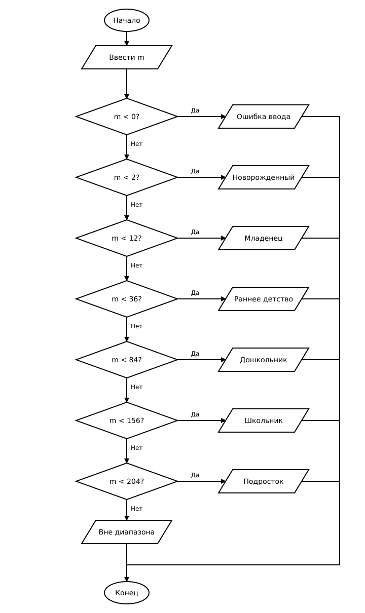

# Домашнее задание к работе 7

## Условие задачи (Вариант 15)

Написать программу, которая по введенному возрасту в месяцах выводит
возрастную категорию ребенка:

- новорожденный – до 2 мес.;
- младенец – до 1 года;
- раннее детство – 1-3 года;
- дошкольник – 3-7 лет;
- школьник – 7-13 лет;
- подросток – 13-17 лет.

---

## 1. Алгоритм и блок-схема

### Алгоритм

1. Настроить русскую локализацию для корректного вывода сообщений.
2. Запросить у пользователя и ввести возраст в месяцах `m`.
3. Если `m < 0` – вывести сообщение об ошибке.
4. Иначе если `m < 2` – вывести «Новорожденный».
5. Иначе если `m < 12` – вывести «Младенец».
6. Иначе если `m < 36` – вывести «Раннее детство».
7. Иначе если `m < 84` – вывести «Дошкольник».
8. Иначе если `m < 156` – вывести «Школьник».
9. Иначе если `m < 204` – вывести «Подросток».
10. Иначе вывести сообщение, что возраст вне диапазона детских категорий.
11. Завершить работу программы.

### Блок-схема



## 2. Реализация программы

Исходный код программы: [Source.c](Source.c)

---

## 3. Результаты работы программы

Пример 1 (m = 1):

```
Введите возраст в месяцах: 1
Новорожденный
```

Пример 2 (m = 24):

```
Введите возраст в месяцах: 24
Раннее детство
```

Пример 3 (m = 100):

```
Введите возраст в месяцах: 100
Школьник
```

---

## 4. Информация о разработчике

- **ФИО:** _впишите свои данные_
- **Группа:** _впишите свою группу_
